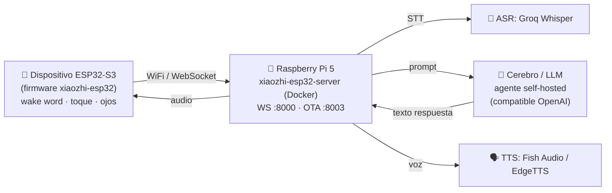

# 🤖 Jarvis — Asistente de voz con IA en ESP32, self-hosted

**Idiomas:** [English](README.md) · **Español**

Una bitácora completa (sin ataduras a la nube) para convertir una **Waveshare ESP32-S3-Touch-LCD-1.85C-BOX** en un asistente de voz con IA, manos libres y en español, con **ojos animados**, una **palabra de activación personalizada ("Jarvis")**, **despertar por toque** y tu **propio cerebro self-hosted** — no la nube del fabricante.

Este repo documenta el camino *real*: los callejones sin salida, los arreglos y la config que funciona. Si compraste la misma placa (o un dispositivo xiaozhi parecido) y chocaste con las mismas paredes, empezá acá.

> Cada secreto (API keys, IPs privadas, MAC del dispositivo) fue reemplazado por `<PLACEHOLDERS>`. Poné los tuyos.

---

## ✨ Qué hace este build

- 🎙️ **Palabra de activación manos libres** — decí *"Jarvis"* para despertarlo (WakeNet en el dispositivo, sin nube).
- 👆 **Despertar por toque** — tocá la pantalla como respaldo (útil cuando la "J" inglesa cuesta pronunciar).
- 👀 **Ojos animados** — una carita reactiva (contento / pensando / etc.) portada del firmware `apollo`.
- 🧠 **Tu propio cerebro** — apunta a un LLM self-hosted, no a `xiaozhi.me`.
- 🗣️ **Voz natural en español** — EdgeTTS (gratis) o Fish Audio (premium, elegís la voz).
- 💤 **Dormido por defecto** — se queda callado durante llamadas/reuniones hasta que lo llamás.
- 🔧 **"Arreglo" del micrófono** — el mic nunca estuvo roto (era el AEC). Se arregla con un flag.
- ⚡ **Optimización de latencia** — matamos una demora oculta de 5 segundos; documentamos el resto.

---

## 🏗️ Arquitectura

- El **dispositivo** corre el firmware xiaozhi-esp32 (nuestro build modificado).
- La **Raspberry Pi** corre `xiaozhi-esp32-server` en Docker y orquesta todo.
- El **cerebro** es cualquier endpoint compatible con OpenAI que vos controles (accesible por tu LAN o un túnel Tailscale).
- **ASR / TTS** son proveedores intercambiables configurados en el servidor.

---

## 📚 Documentación

| # | Guía | Qué contiene |
|---|------|--------------|
| 01 | [Hardware](docs/es/01-hardware.md) | La placa, specs, qué comprar |
| 02 | [Servidor](docs/es/02-servidor.md) | Raspberry Pi + xiaozhi-server + tu cerebro |
| 03 | [Firmware](docs/es/03-firmware.md) | Compilar, el **fix del mic/AEC**, wake word, touch-to-wake |
| 04 | [Ojos animados](docs/es/04-ojos-animados.md) | Portar EmoteDisplay desde `apollo` + el patch |
| 05 | [Voz](docs/es/05-voz.md) | EdgeTTS → Fish Audio, cómo elegir voces |
| 06 | [Optimización](docs/es/06-optimizacion.md) | El `whois` asesino de 5s, streaming, desglose de latencia |
| 07 | [Troubleshooting](docs/es/07-troubleshooting.md) | Cada error que tuvimos y cómo lo resolvimos |

Las docs en inglés están en [`docs/en/`](docs/en/).

---

## 🚀 Arranque rápido (TL;DR)

1. Flasheá el firmware de fábrica, confirmá que el dispositivo bootea (ver [03-firmware](docs/es/03-firmware.md)).
2. Levantá `xiaozhi-esp32-server` en una Raspberry Pi y apuntá el dispositivo ahí (ver [02-servidor](docs/es/02-servidor.md)).
3. Recompilá el firmware con el **fix del AEC + wake word "Jarvis" + touch-to-wake** ([03](docs/es/03-firmware.md)).
4. (Opcional) Agregá los **ojos animados** con [`scripts/apply_emote_eyes.sh`](scripts/apply_emote_eyes.sh) ([04](docs/es/04-ojos-animados.md)).
5. Elegí una **voz** ([05](docs/es/05-voz.md)) y **optimizá la latencia** ([06](docs/es/06-optimizacion.md)).

---

## 🙏 Créditos

Construido sobre estos proyectos open-source — gracias:
- [`xiaozhi-esp32`](https://github.com/78/xiaozhi-esp32) y [`xiaozhi-esp32-server`](https://github.com/xinnan-tech/xiaozhi-esp32-server) (MIT)
- [`apollo`](https://github.com/galfrevn/apollo) / `apollo-firmware` — referencia de EmoteDisplay (MIT)
- Componentes `esp_emote_*` de Espressif (Apache-2.0)

## 📄 Licencia

MIT — ver [LICENSE](LICENSE). La documentación y los scripts son libres de reusar con atribución.
