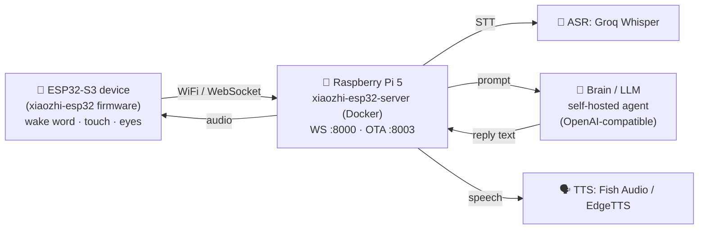
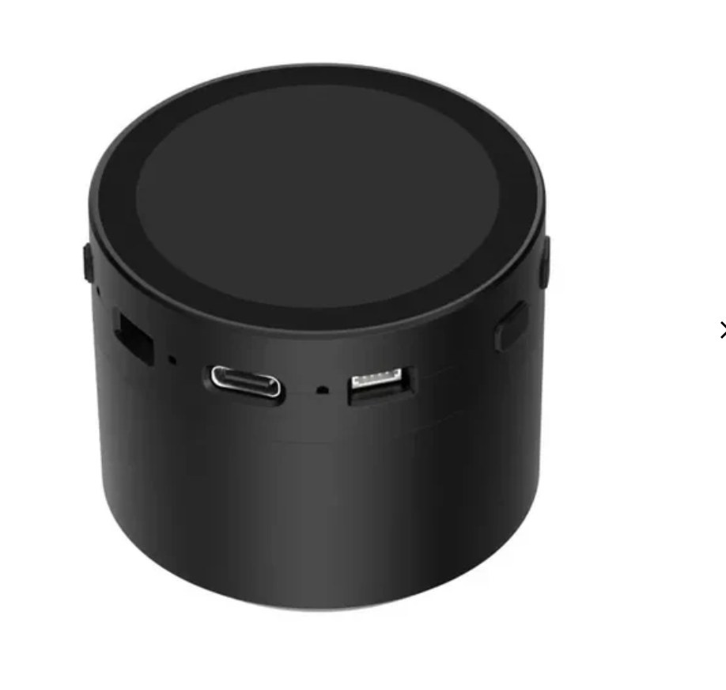

# 🤖 Jarvis — Self-Hosted ESP32 AI Voice Assistant

**Languages:** **English** · [Español](README.es.md)

A complete, no-cloud-lock-in build log for turning a **Waveshare ESP32-S3-Touch-LCD-1.85C-BOX** into a hands-free, Spanish-speaking AI voice assistant with **animated eyes**, a **custom wake word ("Jarvis")**, **touch-to-wake**, and your **own self-hosted brain** — not the vendor cloud.

This repo documents the *real* path: the dead ends, the fixes, and the working config. If you bought the same board (or a similar xiaozhi device) and hit the same walls, start here.

> Every secret (API keys, private IPs, device MAC) has been replaced with `<PLACEHOLDERS>`. Bring your own.

---

## ✨ What this build does

- 🎙️ **Hands-free wake word** — say *"Jarvis"* to wake it (on-device WakeNet, no cloud).
- 👆 **Touch-to-wake** — tap the screen as a backup (handy when the English "J" is hard to pronounce).
- 👀 **Animated eyes** — a reactive face (happy / thinking / etc.) ported from the `apollo` firmware.
- 🧠 **Your own brain** — points at a self-hosted LLM endpoint, not `xiaozhi.me`.
- 🗣️ **Natural Spanish voice** — EdgeTTS (free) or Fish Audio (premium, pick any voice).
- 💤 **Dormant by default** — stays quiet during calls/meetings until you call it.
- 🔧 **Mic "repair"** — the mic was never broken (it was AEC). Fixed with one flag.
- ⚡ **Latency tuning** — killed a hidden 5-second delay; documented the rest.

---

## 🏗️ Architecture

- **Device** runs the xiaozhi-esp32 firmware (our modified build).
- **Raspberry Pi** runs `xiaozhi-esp32-server` in Docker and orchestrates everything.
- **Brain** is any OpenAI-compatible endpoint you control (reachable over your LAN or a Tailscale tunnel).
- **ASR / TTS** are pluggable providers configured in the server.

---

## 📚 Documentation

| # | Guide | What's inside |
|---|-------|---------------|
| 01 | [Hardware](docs/en/01-hardware.md) | The board, specs, what to buy |
| 02 | [Server](docs/en/02-server.md) | Raspberry Pi + xiaozhi-server + your brain |
| 03 | [Firmware](docs/en/03-firmware.md) | Build, the **mic/AEC fix**, wake word, touch-to-wake |
| 04 | [Animated eyes](docs/en/04-animated-eyes.md) | Porting EmoteDisplay from `apollo` + the patch |
| 05 | [Voice](docs/en/05-voice.md) | EdgeTTS → Fish Audio, choosing voices |
| 06 | [Optimization](docs/en/06-optimization.md) | The 5s `whois` killer, streaming, latency breakdown |
| 07 | [Troubleshooting](docs/en/07-troubleshooting.md) | Every error we hit and how we fixed it |
| 08 | [HUD theme](docs/en/08-hud-theme.md) | Optional arc-reactor face — a 4-state HUD |

Spanish docs live in [`docs/es/`](docs/es/).

---

## 🚀 Quick start (TL;DR)

1. Flash the stock firmware, confirm the device boots (see [03-firmware](docs/en/03-firmware.md)).
2. Stand up `xiaozhi-esp32-server` on a Raspberry Pi and point the device at it (see [02-server](docs/en/02-server.md)).
3. Rebuild the firmware with the **AEC fix + "Jarvis" wake word + touch-to-wake** ([03](docs/en/03-firmware.md)).
4. (Optional) Add the **animated eyes** with [`scripts/apply_emote_eyes.sh`](scripts/apply_emote_eyes.sh) ([04](docs/en/04-animated-eyes.md)).
5. Pick a **voice** ([05](docs/en/05-voice.md)) and **tune latency** ([06](docs/en/06-optimization.md)).

---

## 🖼️ Gallery

| The board, stock | HUD / arc-reactor (live) |
|---|---|
|  |  |

### HUD states (live)

<table>
  <tr>
    <td align="center"><b>Idle</b> </td>
    <td align="center"><b>Listening</b> </td>
    <td align="center"><b>Thinking</b> </td>
    <td align="center"><b>Speaking</b> </td>
  </tr>
</table>

Source files live in [`assets/hud-jarvis/`](assets/hud-jarvis/).

## 💸 Running costs

A fully self-hosted voice assistant for **~$1–4/month** — you pay only for what you use, no subscriptions:

| Component | Cost (real usage) |
|---|---|
| 🧠 LLM (DeepSeek) | ~$0.09/mo (≈1.05M tokens over 131 requests) |
| 🗣️ Voice (Fish Audio) | ~$1–3/mo (≈$0.000015/byte; a few min of audio/day) |
| 📝 ASR (Groq Whisper) | ~free (generous free tier) |
| 🥧 Raspberry Pi | cents of electricity |

EdgeTTS keeps the voice free entirely if you skip Fish Audio. Figures are from this build's own dashboards — your mileage will vary.

## 🙏 Credits

Built on top of these open-source projects — thank you:
- [`xiaozhi-esp32`](https://github.com/78/xiaozhi-esp32) & [`xiaozhi-esp32-server`](https://github.com/xinnan-tech/xiaozhi-esp32-server) (MIT)
- [`apollo`](https://github.com/galfrevn/apollo) / `apollo-firmware` — EmoteDisplay reference (MIT)
- Espressif `esp_emote_*` components (Apache-2.0)

## 📄 License

MIT — see [LICENSE](LICENSE). Documentation and scripts are free to reuse with attribution.
