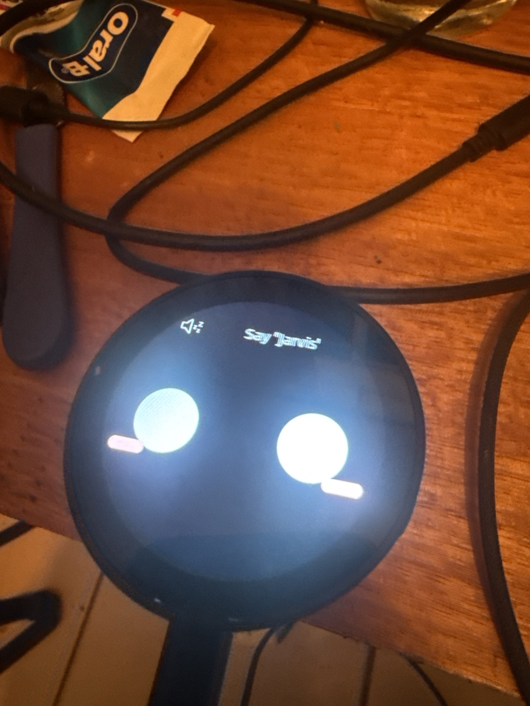

# 04 · Animated eyes (EmoteDisplay)

[← Back to README](../../README.md)

Out of the box the 1.85C shows a minimal "two dots" face. We wanted the **animated eyes** from the [`apollo`](https://github.com/galfrevn/apollo) project. Good news: it's very doable, and it's **legal to copy** (MIT + Apache-2.0).

## The key discovery

`apollo-firmware` is a **fork of the same `xiaozhi-esp32`** firmware, for the **same board**. So this isn't "reinvent a feature" — it's "cherry-pick it from a cousin branch."

- Upstream xiaozhi already ships the emote engine (`emote_display.cc` + Espressif's `esp_emote_*` components), but gates the `USE_EMOTE_MESSAGE_STYLE` flag to a list of boards that **excludes** the 1.85C.
- Apollo simply **wired it to the 1.85C** (same 360×360 round panel as the esp-vocat board).
- The eye animations (`.eaf` files: happy, sad, thinking…) come from Espressif's **`esp_emote_assets`** component and are **downloaded automatically at build time** — no art to draw.

## What the patch changes

The script [`scripts/apply_emote_eyes.sh`](../../scripts/apply_emote_eyes.sh) does all of this, mirroring your own tree's **esp-vocat** board (which already does it in 360×360):

1. **Kconfig** — add the 1.85C to the `USE_EMOTE_MESSAGE_STYLE` `depends on` list.
2. **Board `.cc`** — add a guarded `#include "display/emote_display.h"` and wrap the display init:
   ```cpp
   #if CONFIG_USE_EMOTE_MESSAGE_STYLE
       display_ = new emote::EmoteDisplay(panel, panel_io, DISPLAY_WIDTH, DISPLAY_HEIGHT);
   #else
       display_ = new SpiLcdDisplay(/* ... */);
   #endif
   ```
3. **CMakeLists** — add the board to the emote-asset copy step and set `EMOTE_RESOLUTION "360_360"`.
4. **config.json / sdkconfig.defaults** — `CONFIG_USE_EMOTE_MESSAGE_STYLE=y`, `CONFIG_MMAP_FILE_NAME_LENGTH=32`, `CONFIG_FLASH_EXPRESSION_ASSETS=y`.
5. **Assets** — copy the board's `assets/360_360/emote.json` + battery `.eaf` from esp-vocat. The eye `.eaf` files come from the component.

## One extra fix (important)

The board declares its display as `LcdDisplay* display_;`, but `EmoteDisplay` derives from the **base `Display`** type, so you'll hit:

```
error: cannot convert 'emote::EmoteDisplay*' to 'LcdDisplay*' in assignment
```

Fix — change the member to the base type (esp-vocat already does this; nothing in the 1.85C calls `LcdDisplay`-specific methods, so it's safe):

```cpp
Display* display_;   // was: LcdDisplay* display_;
```

## Apply it

```bash
# from the firmware root on your build machine (e.g. the Pi):
cd ~/xiaozhi-esp32
bash apply_emote_eyes.sh         # see scripts/apply_emote_eyes.sh
# then the display_ base-type fix above (one line), then:
. ~/esp/esp-idf/export.sh
idf.py build && idf.py merge-bin
```

The first build downloads `esp_emote_assets` (~3.4 MB) — it's bigger and slower than usual. Flash the result (see [03-firmware](03-firmware.md)); the merged binary grows ~1.4 MB (the eyes).

## How they react

Your server already sends an `emotion` with each reply, so the eyes react on their own — happy, thinking, etc. To remap which eyes go with which emotion, edit the board's `assets/360_360/emote.json` (a simple JSON) and rebuild.



➡️ Next: [05 · Voice](05-voice.md)
