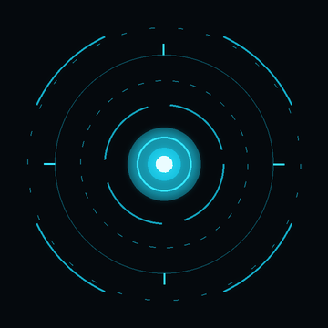

# 08 · HUD theme (arc-reactor face)

[← Back to README](../../README.md)

An optional alternative to the animated eyes: a **sci-fi HUD / arc-reactor** face with four reactive states. 100% original artwork (no Marvel assets), free to reuse.


On real hardware — idle and speaking:

| Idle | Speaking |
|---|---|
|  |  |

## The four states

| State | Animation | When it shows |
|---|---|---|
| Idle | `jarvis_idle.gif` | at rest — slow pulsing reactor |
| Listening | `jarvis_listening.gif` | packed and available (see note) |
| Thinking | `jarvis_thinking.gif` | emotion `thinking` / `confused` — radar sweep |
| Speaking | `jarvis_speaking.gif` | while Jarvis talks — sound-wave equalizer |

All assets live in [`assets/hud-jarvis/`](../../assets/hud-jarvis/).

## Prerequisites

This builds on top of the animated-eyes setup — apply [04 · Animated eyes](04-animated-eyes.md) first (the `esp_emote_*` components and the board wiring must be in place).

## Steps

1. **Convert the GIFs to EAF.** The device plays EAF, not GIF. Use the official converter: <https://esp32-gif.espressif.com/> — upload each GIF, download the `.eaf`. You end up with `jarvis_idle.eaf`, `jarvis_listening.eaf`, `jarvis_thinking.eaf`, `jarvis_speaking.eaf`.

2. **Drop the `.eaf` into the board's emoji dir** on your build machine:
   ```
   main/boards/waveshare/esp32-s3-touch-lcd-1.85c/emoji/
   ```

3. **Apply the theme** with [`scripts/apply_hud_theme.sh`](../../scripts/apply_hud_theme.sh), run from the firmware root:
   ```bash
   cd ~/xiaozhi-esp32
   bash apply_hud_theme.sh
   ```
   It (a) rewrites `assets/360_360/emote.json` to map the states to the HUD animations (see [`emote.json.example`](../../assets/hud-jarvis/emote.json.example)), and (b) patches `main/CMakeLists.txt` so the build packs every `.eaf` in the board's `emoji/` dir (not just the battery ones).

4. **Rebuild and flash:**
   ```bash
   . ~/esp/esp-idf/export.sh
   idf.py build && idf.py merge-bin
   ```
   Then flash `build/merged-binary.bin` (see [03 · Firmware](03-firmware.md)) and reconnect Wi-Fi.

## Make your own (any color / style)

The GIFs are generated procedurally with [`assets/hud-jarvis/generate_hud_gifs.py`](../../assets/hud-jarvis/generate_hud_gifs.py) (Python + Pillow). Edit the color constants near the top (`BRIGHT`, `CORE`, …) and re-run to get amber, green, red, etc. — then convert to EAF as above.

## Note on the "listening" state

`emote.json` maps **emotions** the server sends with each reply. `listening` is an internal engine event, not an emotion entry, so the listening animation is packed and available but may not trigger via `emote.json` alone — at rest the device typically shows `idle`. Wiring the listen/speak *events* to specific animations needs a deeper change in the emote engine; `idle` + `thinking` + `speaking` already give the full reactive effect.

[← Back to README](../../README.md)
