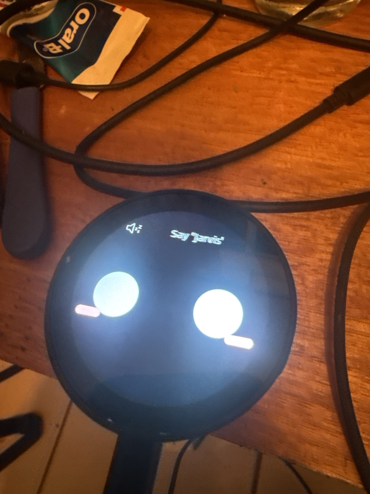

# 04 · Ojos animados (EmoteDisplay)

[← Volver al README](../../README.es.md)

De fábrica la 1.85C muestra una carita mínima de "dos puntos". Nosotros queríamos los **ojos animados** del proyecto [`apollo`](https://github.com/galfrevn/apollo). La buena: es muy factible, y es **legal copiarlo** (MIT + Apache-2.0).

## El descubrimiento clave

`apollo-firmware` es un **fork del mismo `xiaozhi-esp32`**, para la **misma placa**. Así que no es "reinventar una feature" — es "traerla de una rama prima".

- El xiaozhi upstream ya trae el motor de emotes (`emote_display.cc` + los componentes `esp_emote_*` de Espressif), pero restringe el flag `USE_EMOTE_MESSAGE_STYLE` a una lista de placas que **excluye** la 1.85C.
- Apollo simplemente lo **cableó a la 1.85C** (mismo panel redondo 360×360 que la placa esp-vocat).
- Las animaciones de los ojos (archivos `.eaf`: happy, sad, thinking…) vienen del componente **`esp_emote_assets`** de Espressif y se **bajan solas al compilar** — no hay que dibujar nada.

## Qué cambia el patch

El script [`scripts/apply_emote_eyes.sh`](../../scripts/apply_emote_eyes.sh) hace todo esto, calcando la placa **esp-vocat** de tu propio árbol (que ya lo hace en 360×360):

1. **Kconfig** — agregar la 1.85C a la lista `depends on` de `USE_EMOTE_MESSAGE_STYLE`.
2. **`.cc` de la placa** — agregar un `#include "display/emote_display.h"` guardado y envolver el init del display:
   ```cpp
   #if CONFIG_USE_EMOTE_MESSAGE_STYLE
       display_ = new emote::EmoteDisplay(panel, panel_io, DISPLAY_WIDTH, DISPLAY_HEIGHT);
   #else
       display_ = new SpiLcdDisplay(/* ... */);
   #endif
   ```
3. **CMakeLists** — agregar la placa al paso de copia de assets de emote y setear `EMOTE_RESOLUTION "360_360"`.
4. **config.json / sdkconfig.defaults** — `CONFIG_USE_EMOTE_MESSAGE_STYLE=y`, `CONFIG_MMAP_FILE_NAME_LENGTH=32`, `CONFIG_FLASH_EXPRESSION_ASSETS=y`.
5. **Assets** — copiar `assets/360_360/emote.json` + los `.eaf` de batería desde esp-vocat. Los `.eaf` de los ojos vienen del componente.

## Un fix extra (importante)

La placa declara su display como `LcdDisplay* display_;`, pero `EmoteDisplay` deriva del tipo **base `Display`**, así que te vas a topar con:

```
error: cannot convert 'emote::EmoteDisplay*' to 'LcdDisplay*' in assignment
```

Fix — cambiar el miembro al tipo base (esp-vocat ya lo hace; nada en la 1.85C llama métodos específicos de `LcdDisplay`, así que es seguro):

```cpp
Display* display_;   // era: LcdDisplay* display_;
```

## Aplicarlo

```bash
# desde la raíz del firmware en tu máquina de build (ej. la Pi):
cd ~/xiaozhi-esp32
bash apply_emote_eyes.sh         # ver scripts/apply_emote_eyes.sh
# después el fix del tipo base de display_ (una línea), y luego:
. ~/esp/esp-idf/export.sh
idf.py build && idf.py merge-bin
```

El primer build baja `esp_emote_assets` (~3.4 MB) — es más grande y lento que lo habitual. Flasheá el resultado (ver [03-firmware](03-firmware.md)); el binario combinado crece ~1.4 MB (los ojos).

## Cómo reaccionan

Tu servidor ya manda un `emotion` con cada respuesta, así que los ojos reaccionan solos — contento, pensando, etc. Para remapear qué ojos van con qué emoción, editá el `assets/360_360/emote.json` de la placa (un JSON simple) y recompilá.



➡️ Siguiente: [05 · Voz](05-voz.md)
