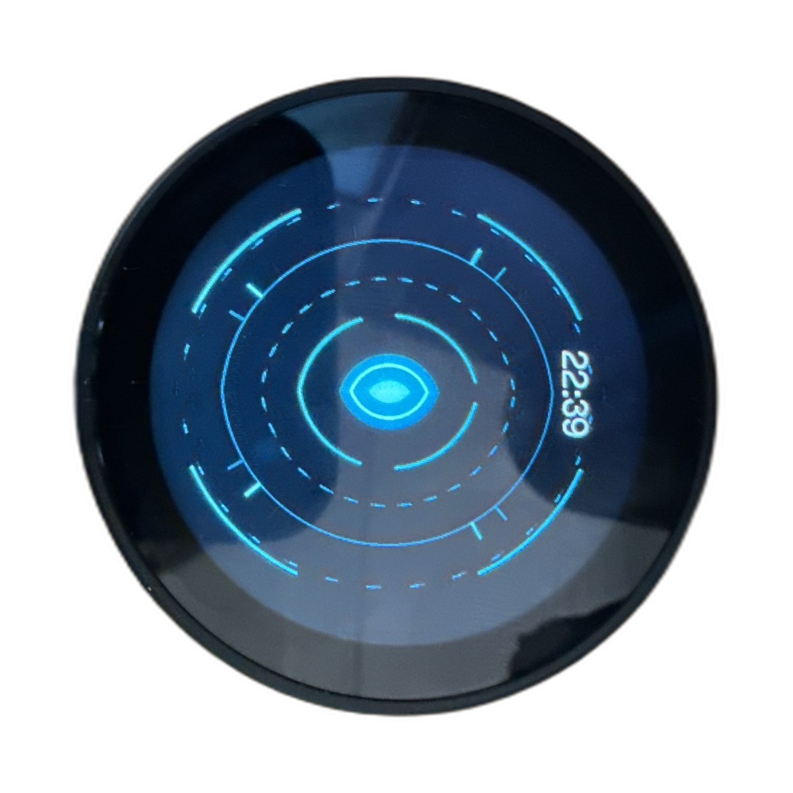
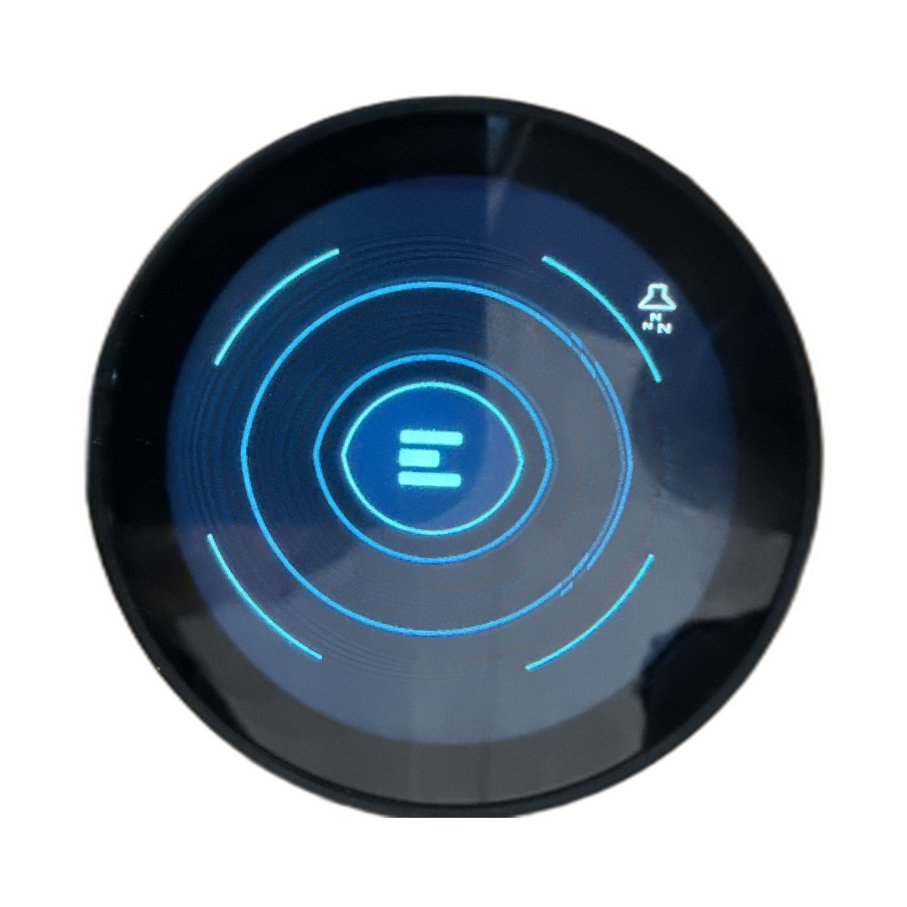

# 08 · Tema HUD (cara arc-reactor)

[← Volver al README](../../README.es.md)

Una alternativa opcional a los ojos animados: una cara **HUD / arc-reactor** sci-fi con cuatro estados reactivos. Arte 100% original (sin assets de Marvel), libre de reusar.


En hardware real — idle y hablando:

| Idle | Hablando |
|---|---|
|  |  |

## Los cuatro estados

| Estado | Animación | Cuándo aparece |
|---|---|---|
| Idle | `jarvis_idle.gif` | en reposo — reactor con pulso lento |
| Escuchando | `jarvis_listening.gif` | empaquetada y disponible (ver nota) |
| Pensando | `jarvis_thinking.gif` | emoción `thinking` / `confused` — barrido de radar |
| Hablando | `jarvis_speaking.gif` | mientras Jarvis habla — ecualizador de ondas |

Todos los assets están en [`assets/hud-jarvis/`](../../assets/hud-jarvis/).

## Prerrequisitos

Esto se monta sobre el setup de ojos animados — aplicá primero [04 · Ojos animados](04-ojos-animados.md) (los componentes `esp_emote_*` y el cableado de la placa tienen que estar).

## Pasos

1. **Convertí los GIFs a EAF.** El device reproduce EAF, no GIF. Usá el conversor oficial: <https://esp32-gif.espressif.com/> — subís cada GIF, bajás el `.eaf`. Te quedan `jarvis_idle.eaf`, `jarvis_listening.eaf`, `jarvis_thinking.eaf`, `jarvis_speaking.eaf`.

2. **Poné los `.eaf` en la carpeta emoji de la placa** en tu máquina de build:
   ```
   main/boards/waveshare/esp32-s3-touch-lcd-1.85c/emoji/
   ```

3. **Aplicá el tema** con [`scripts/apply_hud_theme.sh`](../../scripts/apply_hud_theme.sh), desde la raíz del firmware:
   ```bash
   cd ~/xiaozhi-esp32
   bash apply_hud_theme.sh
   ```
   El script (a) reescribe `assets/360_360/emote.json` mapeando los estados a las animaciones HUD (ver [`emote.json.example`](../../assets/hud-jarvis/emote.json.example)), y (b) parchea `main/CMakeLists.txt` para que el build empaquete todos los `.eaf` de la carpeta `emoji/` (no solo los de batería).

4. **Recompilá y flasheá:**
   ```bash
   . ~/esp/esp-idf/export.sh
   idf.py build && idf.py merge-bin
   ```
   Después flasheá `build/merged-binary.bin` (ver [03 · Firmware](03-firmware.md)) y reconectá el WiFi.

## Hacé el tuyo (cualquier color / estilo)

Los GIFs se generan por código con [`assets/hud-jarvis/generate_hud_gifs.py`](../../assets/hud-jarvis/generate_hud_gifs.py) (Python + Pillow). Editá las constantes de color cerca del inicio (`BRIGHT`, `CORE`, …) y volvé a correrlo para obtener ámbar, verde, rojo, etc. — después convertís a EAF como arriba.

## Nota sobre el estado "escuchando"

El `emote.json` mapea **emociones** que el server manda con cada respuesta. `listening` es un evento interno del motor, no una emoción, así que la animación de escucha queda empaquetada y disponible pero puede no dispararse solo con el `emote.json` — en reposo el device suele mostrar `idle`. Conectar los *eventos* listen/speak a animaciones puntuales requiere un cambio más profundo en el motor de emotes; `idle` + `thinking` + `speaking` ya te dan el efecto reactivo completo.

[← Volver al README](../../README.es.md)
